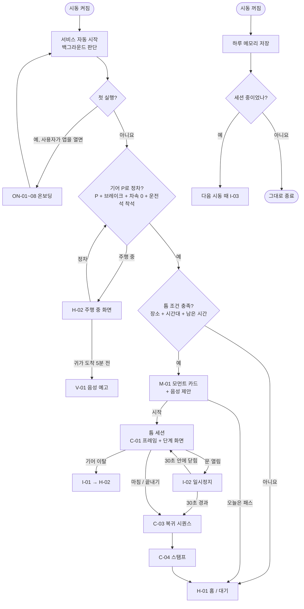
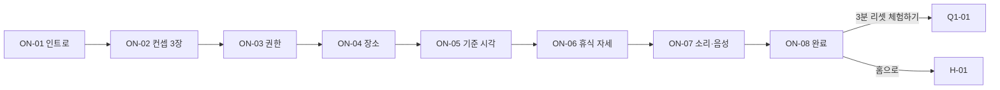
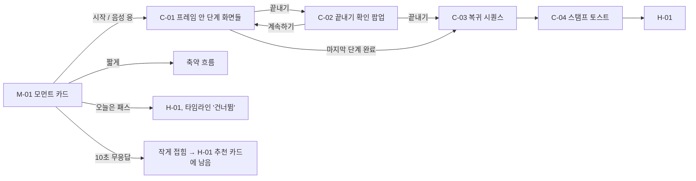
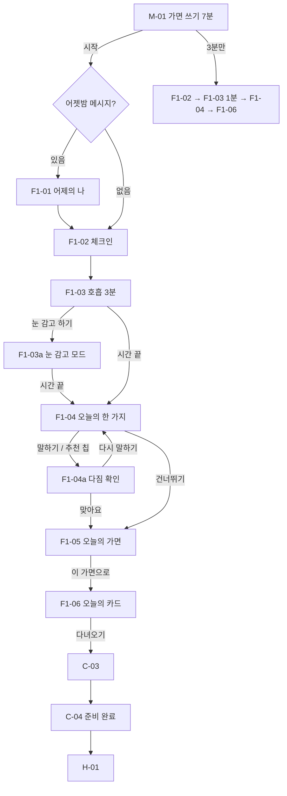
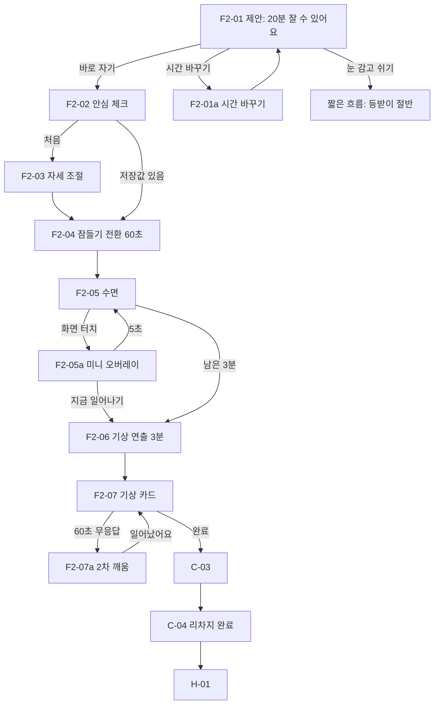
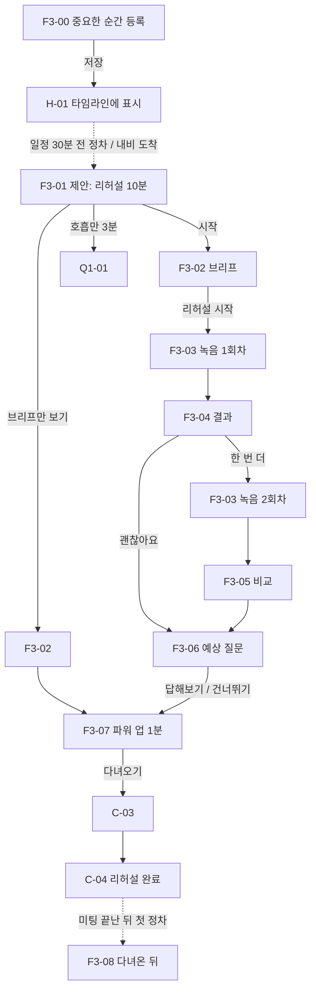
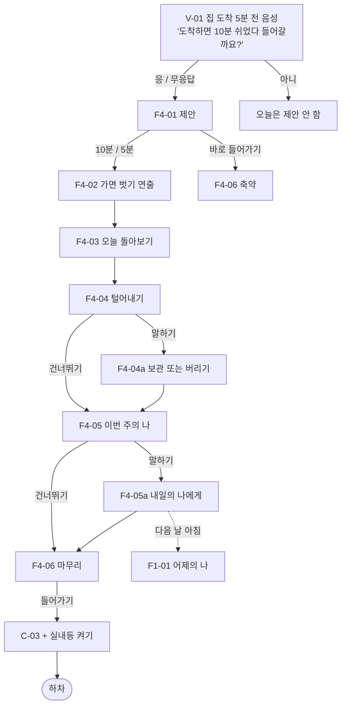

# 틈틈 화면 플로우와 화면별 스펙

## 이 문서를 읽는 법

각 표는 한 행이 한 화면이다. 열은 다섯 개다.

- **ID / 화면**
- **요소·카피**: 화면에 들어가는 것. 따옴표 안의 문장은 실제 카피다.
- **차의 동작**: Cabin 패널에 보여야 하는 것. 실제 차에서는 SDK 호출이 된다.
- **사용자가 느끼는 것**: 연출 의도. 일부 표에만 있다.
- **다음**: 버튼별로 어느 화면으로 가는지, 그리고 자동 전이.

예시 시각은 덱의 시나리오와 맞췄다: S1 08:40, S2 12:35, S3 15:40, S4 19:10.

`{ }` 안은 변수다. 예: `{남은분}`, `{가면이름}`

---

## 0. 앱 생명주기 (시동 켜짐 → 꺼짐)



- **앱을 직접 열었을 때**:
  - 온보딩 전이면 `ON-01`로 간다.
  - 주행 중이면 `H-02`로 간다.
  - 정차 중이면 `H-01`로 간다.
- **도착 직후**: 조명과 공조가 먼저 은은하게 바뀐다. 따뜻한 저조도로 2초 동안 페이드한다. 시트는 [시작]을 누른 뒤에만 움직인다.

---

## 1. 온보딩 ON (최초 1회)



| ID | 화면 | 요소·카피 | 차의 동작 | 다음 |
|---|---|---|---|---|
| ON-01 | 인트로 | 화면 가운데 틈 라이트가 천천히 열리며 로고가 나타난다. 메인 카피 "바쁜 하루 사이, 나를 위한 틈" | 앰비언트가 쿨 화이트 30%로 페이드 인 | [시작하기] → ON-02 |
| ON-02 | 컨셉 소개 3장 | ① "하루 네 번, 차가 먼저 틈을 찾아요" ② "차가 공간을 바꿔요. 시트, 조명, 바람까지" ③ "짧은 틈이 쌓여 하루가 내 것이 돼요". 점 인디케이터, 좌우 스와이프 | ②에서 앰비언트 색이 세 번 바뀌는 미리보기 | [다음] × 3 → ON-03, [건너뛰기] → ON-03 |
| ON-03 | 권한 안내 | 항목마다 이유를 한 줄로 쓴다. 차량 제어: "쉬는 동안 시트·조명·공조·창문을 맞춰요". 마이크: "다짐과 회고를 말로 남겨요". 위치: "회사와 집에 도착한 걸 알아요" | — | [허용하고 계속] → ON-04. 거부한 항목은 T-01 "이 기능 없이 진행해요" |
| ON-04 | 장소 등록 | 회사 카드와 집 카드. 카드마다 [지금 위치로], [주소 검색]. 등록하면 카드에 주소 한 줄이 보인다 | — | [다음] → ON-05, [나중에] → ON-05 (장소 기반 제안 꺼짐) |
| ON-05 | 하루 기준 시각 | 출근 시각 Spinner (Time, 기본 09:00), 점심 복귀 시각 Spinner (13:00), 걷는 시간 Stepper (3분). 아래에 미리보기 "08:40에 도착하면 가면 쓰기 7분을 열어 드려요" | — | [다음] → ON-06 |
| ON-06 | 휴식 자세 저장 | 옆에서 본 시트 실루엣과 현재 등받이 각도, 각도 Stepper. 정차 중일 때만 활성화된다 | [더 젖혀 보기]를 누르면 등받이가 실제로 움직이고 [멈춤]이 보인다 | [지금 자세로 저장], [기본값 쓰기] → ON-07. 주행 중이면 "다음 정차 때 맞출게요" 후 자동 통과 |
| ON-07 | 소리·음성 | 사운드 칩 4개 (빗소리, 백색소음, 숲, 무음)와 미리 듣기, 기상송 선택, 음성 안내 토글 | 미리 듣기 재생 | [다음] → ON-08 |
| ON-08 | 완료 | "내일 아침 회사에 도착하면 첫 틈을 열어 드릴게요"와 등록 요약 (회사, 집, 출근 09:00) | 틈 라이트가 닫히며 앰비언트가 원래대로 | [3분 리셋 체험하기] → Q1-01, [홈으로] → H-01 |

- 온보딩 중에 차가 출발하면 진행 상태를 저장하고 `H-02`로 간다. 다음 정차 때 멈춘 단계부터 이어서 보여 준다.
- `ON-08`의 [3분 리셋 체험하기]는 처음 쓴 날에도 차가 움직이는 경험을 바로 보여 주기 위한 장치다.

---

## 2. 홈 H

### H-01 홈 (정차)

**Portrait (840 × 1184, 기본)**

```
┌──────────────────────────────────┐
│ [앱아이콘] 틈틈          [기록][설정] │  ← Page navigation Main (80)
│                                  │
│ 11월 10일 월요일                   │  ← label.min
│ 점심 잘 먹었어요?                  │  ← title
│ ┌──────────────────────────────┐ │
│ │ ● 단호한 나 · "기획안 초안"     │ │  ← 오늘의 카드 칩 (F1 마친 날)
│ └──────────────────────────────┘ │
│ ┌──────────────────────────────┐ │
│ │ 다음 틈 · 12:35 점심 리차지   ┃│ │  ← 메인 추천 카드 (오른쪽 끝 틈 빛)
│ │ 점심 먹고 오면 20분 잘 수 있어요 │ │
│ │ [        3분 리셋        ]    │ │  ← 주 버튼 L (상태별 하나)
│ └──────────────────────────────┘ │
│ 오늘의 틈                          │
│ ● 아침   가면 쓰기 · 단호한 나   ✓  │  ← 타임라인 (세로 4칸, 칸 높이 112)
│ ○ 점심   리차지 예정 12:35          │
│ ○ 중요한 순간  A사 미팅 16:00       │
│ ○ 저녁   가면 벗기                  │
│ [중요한 순간 등록]                  │  ← 보조 버튼 M
└──────────────────────────────────┘
```

**Landscape (1700 × 1184, 확장)**: 왼쪽 열은 Portrait와 같다. 오른쪽 열에 다음이 추가된다.

- 주간 스탬프 (월~금 5칸 막대)와 '되찾은 시간' 숫자
- 타임라인을 가로 4칸으로 펼친 버전

| 영역 | 요소 | 규칙 |
|---|---|---|
| Page navigation | 앱 아이콘, "틈틈", Suffix Icon button [기록] → R-01, [설정] → ST | Pleos Page navigation Main (높이 80). 아이콘에는 라벨을 함께 표시한다 |
| 날짜·인사 | 날짜, 시간대 인사 한 줄 | 아침 "좋은 아침이에요", 점심 "점심 잘 먹었어요?", 오후 "오후도 반 왔어요", 저녁 "오늘도 수고했어요" |
| 오늘의 카드 칩 | 가면 색 점, 가면 이름, 다짐 한 줄 | F1을 마친 날에만 보인다. 누르면 R-02 |
| 메인 추천 카드 | 상황별 문구와 버튼 하나 (아래 표) | Surface basic, 라디우스 32. 카드 오른쪽 끝에 틈 라이트가 아주 약하게 비친다 |
| 오늘의 틈 타임라인 | 아침, 점심, 중요한 순간, 저녁 4칸 | 칸 상태는 완료 ✓, 예정, 건너뜀, 해당 없음. 칸을 누르면 지금 가능한 세션은 시작하고, 지난 칸은 R-02로 간다 |
| 빠른 실행 | [중요한 순간 등록] → F3-00. [3분 리셋]은 추천 카드에 없을 때만 보조 버튼으로 | 보조 버튼 M |
| 주간 스탬프 (Landscape) | 월~금 5칸, 칸마다 그날 채운 틈 개수를 막대로 | 누르면 R-01 |

메인 추천 카드의 상태별 내용은 다음과 같다.

| 상태 | 카드 문구 | 버튼 → 다음 |
|---|---|---|
| 지금 틈이 있음 | "출근까지 20분 · 가면 쓰기 7분" | [시작] → 해당 세션 첫 화면 |
| 틈 없음, 다음 틈이 예정됨 | "다음 틈 · 12:35 점심 리차지" | [3분 리셋] → Q1-01 |
| 오늘 마무리 후 | "오늘의 틈 3칸 완료" + 하루 색 | [오늘 기록 보기] → R-02 |
| 주말·휴일 | "오늘은 쉬는 날이에요" | [3분 리셋] → Q1-01 |
| 장소·시각 미등록 | "회사와 집을 등록하면 틈을 찾아 드려요" | [등록하기] → ST-01 |

### H-02 주행 중 화면

- 큰 글씨 한 줄 "정차하면 틈을 열 수 있어요"와 오늘 진행 점 4개만 보여 준다.
- 터치할 수 있는 요소가 없다.
- 주행 제한 신호가 오면 어떤 화면에서든 즉시 이 화면으로 바뀐다. 전이는 200ms 페이드 하나뿐이다.
- 주행 중에 나오는 것은 `V-01` 음성 하나다. 프로토타입에서는 화면 아래에 음성 자막 바로 보여 준다.

### H-03 세션 컴팩트 뷰 (P1)

- **언제**: 세션 중에 운전자가 다른 앱 (예: 내비)을 열어 틈틈이 1:1 분할의 한 창 (Portrait)으로 밀려났을 때다.
- **보여 주는 것**: 세션 이름, 남은 시간 (`num.l`), 틈 라이트 미니, [크게 보기] (Landscape로 전환), [끝내기].
- 차의 연출 (조명, 시트, 공조)은 그대로 이어진다.
- 대기 중 홈은 별도 화면이 아니다. H-01 Portrait가 곧 분할 창 홈이다.

---

## 3. 세션 공통 프레임



| ID | 화면 | 요소·카피 | 차의 동작 | 다음 |
|---|---|---|---|---|
| M-01 | 모먼트 카드 | 화면이 어두워지고 가운데 틈 라이트가 열리며 카드가 나온다. 제목 (세션 이름), 큰 숫자 (남은 시간 또는 길이), 부제 한 줄, 주 버튼 [시작], 보조 [{짧은버전}], [오늘은 패스]. 음성 힌트 "'시작'이라고 말해도 돼요" | TTS로 같은 제안을 한 번 한다 | [시작] → 세션 첫 화면, [짧게] → 축약, [오늘은 패스] → H-01, 10초 무응답 → 접힘 |
| C-01 | 진행 프레임 | 상단 단계 점 (현재 단계 강조), 우상단 [끝내기], 하단 엣지 라이트 (남은 시간에 따라 줄어듦, 누르면 "{남은분}분 남았어요"), 가운데 영역만 단계별로 바뀜 | 세션 시작 시 시트, 조명, 공조 값을 저장한다 (`saveCabinSnapshot`) | [끝내기] → C-02 |
| C-02 | 끝내기 확인 팝업 | System popup Medium (808, 라디우스 48). "지금 끝낼까요? 차를 원래대로 돌려놓을게요". 버튼 Horizontal | 일시정지 | [끝내기] → C-03, [계속하기] → 이전 단계 |
| C-03 | 복귀 시퀀스 | "차를 원래대로 돌려놓는 중" + 체크 3개 (등받이, 조명, 공조. 창문을 열었으면 창문까지). 항목마다 차례로 ✓ | 저장해 둔 값으로 복원. 등받이가 움직이는 동안 [멈춤] | 자동 (5~10초) → C-04. [끝내기]로 온 경우 → H-01 (스탬프 없음) |
| C-04 | 스탬프 토스트 | Toast popup (최대 폭 792, 하단·좌우 24) 3초. "{틈이름} 완료 · 연속 {n}일". 스탬프 아이콘이 찍히는 마이크로 모션 하나 | 짧은 완료음 | 3초 후 → H-01 |
| T-01 | 안내 토스트 | Toast popup 3초 (C-04와 같은 자리). 예: 동승자 "혼자일 때 보여 드릴게요", 미지원 "이 차는 블라인드가 없어서 건너뛸게요", 저장 "저장했어요" | — | 해당 단계 건너뜀, 다음 단계로 |

M-01 변형별 카피는 다음과 같다.

| 변형 | 제목 | 큰 숫자 | 부제 | 보조 버튼 |
|---|---|---|---|---|
| F1 | 가면 쓰기 | 7분 | "출근까지 20분 남았어요" | [3분만], [오늘은 패스] |
| F2 (`F2-01`) | 리차지 | 20분 | "1시 복귀까지 25분 · 걷는 시간까지 계산했어요" | [시간 바꾸기], [눈 감고 쉬기], [오늘은 패스] (주 버튼 [바로 자기]) |
| F3 (`F3-01`) | 리허설 | 10분 | "A사 미팅까지 20분 남았어요" | [브리프만 보기], [호흡만 3분], [오늘은 패스] |
| F4 (`F4-01`) | 가면 벗기 | 10분 | "오늘도 수고했어요. 10분만 '나'로 있다 올라갈까요?" | [5분], [바로 들어가기] (주 버튼 [10분]) |

F2와 F3는 보조 버튼이 셋이다. 셋째 버튼은 텍스트 링크 스타일로 무게를 더 낮춘다.

### 세션 화면 원칙

- 한 화면에 주 버튼은 하나다. 모든 버튼은 음성으로도 누를 수 있다.
- 세션 중에는 전체 화면을 쓴다. 배경은 캐빈 다크이고, 포인트는 현재 라이트 색이다 (가면 색, 앰버 등).
- 선택이 필요 없는 단계는 자동으로 넘어가고, 선택이 필요한 단계만 기다린다.
- 단계가 바뀔 때의 전이는 크로스페이드와 8px 상승 (320ms)이다. 장면이 바뀌는 순간에만 틈 라이트를 쓴다.

---

## 4. F1 가면 쓰기 (출근 직후, 7분)

**상황 (S1)**: 08:40, 회사 지하주차장. 9시 출근까지 20분이 남았다. "들어가기 싫다… 오늘 10시 회의 어떡하지."



| ID | 화면 | 요소·카피 | 차의 동작 | 사용자가 느끼는 것 | 다음 |
|---|---|---|---|---|---|
| F1-01 | 어제의 나 (조건부) | "어젯밤의 내가 남긴 말이 있어요". 편지 카드 (MaruBuri), 재생 파형, 자막. 전날 F4-05a 메시지가 있을 때만 | TTS 또는 녹음으로 재생 | 어제의 내가 오늘의 나를 응원한다 | 재생 끝 → F1-02, [건너뛰기] |
| F1-02 | 체크인 | "지금 마음은 어때요?" 큰 선택 카드 3개: [긴장돼요], [무거워요], [괜찮아요]. 음성으로도 답할 수 있다 | 시트 위치를 저장하고 등받이를 5° 뒤로 젖힌다. 앰비언트는 따뜻한 저조도 | 내 상태를 인정받는다 | 선택 → F1-03 (호흡 종류 결정) |
| F1-03 | 호흡 (3분) | 화면 가운데 **틈 라이트**가 숨을 쉰다. 들숨 1단 (2초)에 열리고, 들숨 2단 (1초)에 조금 더 열리고, 긴 날숨 (6초)에 닫힌다. 문구는 한 줄 "들이쉬고, 한 번 더, 길게 내쉬세요". 처음 3회만 문구, 이후에는 숨 이름만. 우하단 [눈 감고 하기] | 앰비언트 밝기가 틈 라이트와 같은 박자로 움직인다 (들숨 2단계 상승, 날숨 하강). 풍량 1단. 처음 3회만 음성 안내, 이후에는 소리만 | 화면을 보지 않아도 차 안 전체가 호흡을 이끈다 (wow) | 3분 후 자동 → F1-04 |
| F1-03a | 눈 감고 모드 | 화면 최소 밝기. 틈 라이트는 1px 선으로만 남는다 | 빛과 소리로만 진행 | — | 터치 → F1-03, 자동 → F1-04 |
| F1-04 | 오늘의 한 가지 | "오늘 꼭 끝낼 한 가지는?" 큰 마이크 버튼, 실시간 받아쓰기, 추천 칩 (어제 이월된 일 "기획안 초안") | 마이크가 켜지면 앰비언트를 살짝 밝힌다 | 머릿속이 한 줄로 정리된다 | [말하기] → F1-04a, 추천 칩 → F1-04a, [건너뛰기] → F1-05 |
| F1-04a | 다짐 확인 카드 | 받아쓴 문장을 크게 보여 준다 (MaruBuri). "이렇게 적을게요" | — | — | [맞아요] → F1-05, [다시 말하기] → F1-04 |
| F1-05 | 오늘의 가면 | "오늘 회사에서 어떤 나로 있을까요?" 가면 카드 5장을 좌우로 넘긴다. 카드마다 이름, 한 줄 설명, 그 색의 틈 라이트가 있다. 가운데 카드가 크고 양옆은 흐리다 | 카드를 넘길 때마다 앰비언트가 그 가면 색으로 1초 크로스페이드한다 | 가면이 억지가 아니라 내가 고른 도구가 된다 | [이 가면으로] → F1-06 |
| F1-06 | 오늘의 카드 | 한 장짜리 카드. 날짜, 가면 이름과 색, 다짐 (MaruBuri 대형). 음성 "오늘의 한 가지, {다짐}. {가면이름}로, 다녀오세요." | 앰비언트가 아침빛 (쿨 화이트)으로 밝아진다. 등받이 원위치, 외기 유입, 1℃ 낮춤, 열선 끔 | 준비된 상태로 내린다 | [다녀오기] → C-03 → C-04 "준비 완료 · 연속 {n}일" → H-01 |

가면 다섯 개는 다음과 같다. 이름 옆 한 줄은 F1-05 카드 설명이다.

| 가면 | 언제 | 색 토큰 |
|---|---|---|
| 차분한 나 | "긴장되는 회의가 있는 날" | `mask.calm` 딥 블루 |
| 단호한 나 | "거절하거나 협상해야 하는 날" | `mask.firm` 버밀리언 |
| 다정한 나 | "사람을 많이 만나는 날" | `mask.warm` 코랄 |
| 집중하는 나 | "혼자 끝낼 일이 많은 날" | `mask.focus` 쿨 화이트 |
| 유연한 나 | "일정이 자주 바뀌는 날" | `mask.flex` 세이지 그린 |

체크인에 따라 호흡이 달라진다.

| 체크인 | 호흡 |
|---|---|
| 긴장돼요 | 진정 호흡: 들숨 2단, 날숨 6초 |
| 무거워요 | 깨우는 호흡: 들숨을 강조, 날숨 4초 |
| 괜찮아요 | 정리 호흡 1분 후 바로 다짐으로 |

### 분기

- **[3분만] 또는 남은 시간 5~9분**: F1-02 → F1-03 (1분) → F1-04 → F1-06. 가면은 어제 것을 그대로 쓰고, F1-06에 [가면 바꾸기] 링크만 둔다.
- **남은 시간 5분 미만**: F1-04 → F1-06 (다짐만).
- **동승자 착석**: 음성을 끄고 같은 화면으로 진행한다. F1-04는 말하기 대신 추천 칩만 보여 준다.
- **호흡 중 기어 변경**: I-01.

---

## 5. F2 리차지 (점심 직후, 최대 20분)

**상황 (S2)**: 12:35, 회사 지하주차장. 밥을 먹고 25분이 남았다. 식곤증이 온다. "회사에서 엎드려 자면 눈치 보이고, 알람 못 들으면 어떡하지."

**시간 공식**: 리차지 시간 = 13:00 − 12:35 − 걷는 시간 3분 − 깨어나는 시간 2분 = **20분**. 이 20분은 잠들기 1분, 휴식 16분, 기상 연출 3분으로 나뉜다.



| ID | 화면 | 요소·카피 | 차의 동작 | 사용자가 느끼는 것 | 다음 |
|---|---|---|---|---|---|
| F2-01 | 제안 (M-01 변형) | 제목 "리차지", 큰 숫자 "20분" (`num.hero`), 부제 "1시 복귀까지 25분 · 걷는 시간까지 계산했어요" | 음성으로 같은 제안 | 계산을 대신 해 준다 | [바로 자기] → F2-02, [시간 바꾸기] → F2-01a, [눈 감고 쉬기] → 짧은 흐름, [오늘은 패스] → H-01 |
| F2-01a | 시간 바꾸기 팝업 | System popup 안에 Tabs Solid M (10 · 15 · 20분)과 복귀 시각 Spinner (Time). 바꾸면 큰 숫자가 바로 갱신된다 | — | — | [확인] → F2-01 |
| F2-02 | 안심 체크 | 체크 4개가 0.4초 간격으로 하나씩 켜진다: 기어 P ✓, 문 잠김 ✓ (안 잠겼으면 [잠그기]), 창문 닫힘 ✓, "오후 첫 일정 13:30 팀 회의". 아래에 사운드 칩 4개 | 문 잠금 상태와 창문 위치를 확인한다. [잠그기]를 누르면 잠근다 | 안심하고 눈을 감을 수 있다 | [다음] → F2-03 (처음) 또는 F2-04 |
| F2-03 | 자세 조절 (최초 1회) | 옆에서 본 시트 실루엣, 각도 숫자 (`num.l`), Stepper (더 젖히기 / 덜 젖히기) | 등받이가 실제로 움직인다. 이동 중에는 [멈춤] | — | [이 각도로 저장] → F2-04 |
| F2-04 | 잠들기 전환 (60초) | 화면이 서서히 어두워진다. 틈 라이트가 천천히 좁아져 선이 되고, 끝내 점 하나로 줄어든다. 카피 "20분 뒤에 깨워 드릴게요" (10초 뒤 사라짐). 하단에 차가 하는 일 진행 표시 (등받이, 블라인드, 조명, 공조)가 작게 | 등받이를 수면 각도로 천천히 젖힌다. 블라인드와 스마트글라스를 닫는다 (지원 시). 실내등을 끄고 앰비언트를 딥 블루 5%로 낮췄다가 30초 뒤 끈다. 공조는 24℃, 풍량 1~2, 외기 소량. 계절에 따라 열선 또는 통풍 1단. 사운드를 페이드 인한다 | 차가 침실로 바뀌는 순간 (wow) | 자동 → F2-05 |
| F2-05 | 수면 | 검은 화면과 가운데 작은 호흡 점 하나 (0.1 Hz 맥동, 밝기 4%) | 기어, 문, 착석 상태를 계속 감시한다 | 시계를 안 봐도 된다 | 터치 → F2-05a, 남은 3분 → F2-06 |
| F2-05a | 미니 오버레이 | "{남은분}분 남았어요", [지금 일어나기], [3분 더] (복귀 시각에 여유가 있을 때만) | — | — | 5초 후 자동으로 숨김, [지금 일어나기] → F2-06 축약 (30초) |
| F2-06 | 기상 연출 (3분) | 화면 아래에서 앰버 빛이 일출처럼 차오르고, 틈 라이트가 앰버로 다시 열린다. 화면보다 캐빈이 주인공이다 | 3분 전: 앰비언트 앰버 1% → 60%, 사운드를 새소리로 바꾼다. 2분 전: 온도 2℃ 낮춤, 풍량 3, 외기. 1분 전: 등받이를 천천히 세우고 블라인드를 연다. 0분: 운전석 창문 2cm 열림, 음성 "1시 5분 전이에요. 개운하게 일어나요." 기상송 재생 | 알람에 놀라지 않고 몸이 먼저 깬다 (wow) | 자동 → F2-07 |
| F2-07 | 기상 카드 | "20분 회복 완료 · 이번 주 3번째", 아침 다짐 다시 보기 (오늘의 카드 칩), "오후 첫 일정까지 35분" | — | 오후를 버틸 힘이 생겼다 | [창문 닫기], [완료] → C-03 → C-04 → H-01. 60초 무응답 → F2-07a |
| F2-07a | 2차 깨움 | "일어났어요?" 큰 버튼 하나 | 소리를 키우고 실내등을 켜고 음성을 반복한다 | — | [일어났어요] → F2-07 |

### 분기

- **[눈 감고 쉬기] 또는 리차지 7분 미만**: F2-02 → F2-04 → F2-05 → F2-06 (1분) → F2-07. 등받이는 절반만 젖힌다.
- **자는 동안 문이 열림**: I-02 일시정지. 다시 닫히면 "더 쉴까요?"를 묻는다.
- **블라인드가 없는 차종**: F2-02에 "햇빛 가리개를 펼쳐 주세요" 한 줄을 추가한다.
- **내연기관 차**: F2-02에 공회전 안내를 띄우고 공조는 최소 모드로 둔다. 외기 온도가 극단적이면 최대 15분으로 제한한다.

---

## 6. F3 리허설 (중요한 순간 직전, 10분)

**상황 (S3)**: 15:40, 거래처 건물 주차장. 16시 미팅까지 20분이 남았다. "애매하게 남았는데… 첫마디를 뭐라고 하지."

F3는 등록 (F3-00)이 있어야 제안이 뜨는 유일한 기능이다.



| ID | 화면 | 요소·카피 | 차의 동작 | 사용자가 느끼는 것 | 다음 |
|---|---|---|---|---|---|
| F3-00 | 중요한 순간 등록 | 음성 한 문장 입력 우선: "4시 A사 신제품 제안 미팅". 인식 결과를 칸에 채워 보여 준다: 제목, 시각, 상대 (선택), 핵심 키워드 3칩, 예상 질문 (선택) | — | — | [저장] → H-01 (타임라인 '중요한 순간' 칸에 표시) |
| F3-01 | 제안 (M-01 변형) | 제목 "리허설", 큰 숫자 "10분", 부제 "A사 미팅까지 20분 남았어요" | 음성 제안 | 애매한 15분에 할 일이 생긴다 | [시작] → F3-02, [브리프만 보기] → F3-02 → F3-07, [호흡만 3분] → Q1-01, [오늘은 패스] |
| F3-02 | 브리프 | 미팅명, 시간, 상대. "내 목표" 한 줄 (MaruBuri). 키워드 칩 3개 | 집중 모드: 쿨 화이트 조명 70%, 등받이 바로 세움, 22℃ | 흩어진 생각이 모인다 | [키워드 고치기], [리허설 시작] → F3-03 |
| F3-03 | 리허설 녹음 | "첫 3문장을 소리 내 말해 보세요". 큰 마이크 버튼, 목표 60초 바, 실시간 자막 (키워드는 말하는 순간 하이라이트), 경과 시간 | 녹음 중에는 앰비언트를 고정한다 | 내 말을 객관적으로 본다 | [끝] 또는 3초 침묵 → 1회차면 F3-04, 2회차면 F3-05 |
| F3-04 | 결과 카드 | 지표 4개: 말한 시간 "72초", 키워드 "2/3", 군말 "4회", 속도 "조금 빨라요". 가장 아쉬운 지표 하나만 강조하고 팁 한 줄 "'음'을 줄이면 더 단단하게 들려요" | — | — | [한 번 더] → F3-03, [괜찮아요] → F3-06 |
| F3-05 | 비교 카드 | "72초 → 58초 · 군말 4 → 1 · 키워드 3/3". 칭찬 한 줄 "두 번 만에 14초 줄였어요". 변화량을 숫자 롤링으로 보여 준다 | 짧은 성취음 | 10분 안에 나아졌다는 작은 성취 (wow) | [다음] → F3-06 |
| F3-06 | 예상 질문 (선택) | 질문 카드 1장 "가장 큰 차별점이 뭐예요?" | 음성으로 질문을 읽어 준다 | 실전에서 덜 당황한다 | [답해보기] → 녹음 후 시간만 피드백 → F3-07, [건너뛰기] → F3-07 |
| F3-07 | **파워 업 (1분)** | 화면에 첫 문장 하나만 크게 띄운다. 위에 작게 "긴장이 아니라 설렘이에요". 소리 내 한 번 따라 말하도록 마이크 아이콘을 작게 둔다 | 저음이 강한 파워 송을 재생한다. 앰비언트가 쿨 화이트에서 아침에 고른 가면 색으로 바뀌고, 비트에 맞춰 밝기가 아주 약하게 맥동한다. 공조를 원복한다. 음성 "첫 문장만 기억하세요." | 다시 가면을 쓰고 들어간다 | [다녀오기] → C-03 → C-04 "리허설 완료" |
| F3-08 | 다녀온 뒤 (재탑승 시) | "미팅 어땠어요?" [잘 됐어요], [그럭저럭], [힘들었어요]와 한 줄 음성 메모 | — | 기록이 저녁 회고로 이어진다 | 선택 → 저장 → H-01. F4-03 타임라인에 표시 |

### 분기

- **동승자 착석**: F3-03 녹음 단계를 숨기고 F3-02 → F3-07만 제공한다.
- **등록한 일정 없이 홈에서 직접 열면**: F3-00 등록 화면부터 시작한다.
- **남은 시간 10분 미만**: F3-02 → F3-07.
- **F3-08**: 미팅이 끝날 것으로 예상되는 시각 이후 첫 정차 때 한 번만 뜨고, 응답이 없으면 사라진다.
- **STT가 군말을 받아쓰지 못할 때**: '군말' 지표를 '침묵 구간' 지표로 바꾼다.

---

## 7. F4 가면 벗기 (귀가 직전, 10분)

**상황 (S4)**: 19:10, 아파트 지하주차장. 방전됐다. 아내와 딸이 기다리는데 바로 올라갈 기운이 없다. 그냥 두면 폰만 넘기다 30분이 지나간다.

F4는 주행 중 음성 예고 (V-01)로 시작하는 유일한 기능이다.



| ID | 화면 | 요소·카피 | 차의 동작 | 사용자가 느끼는 것 | 다음 |
|---|---|---|---|---|---|
| V-01 | 음성 예고 (화면 없음) | 집 도착 5분 전 "도착하면 10분 쉬었다 들어갈까요?" 프로토타입에서는 하단 음성 자막 바로 보여 준다 | TTS, STT ("응", "아니") | 죄책감 없는 허락을 미리 받는다 | "응" 또는 무응답 → 도착 시 F4-01, "아니" → 오늘은 제안하지 않음 |
| F4-01 | 제안 (M-01 변형) | "오늘도 수고했어요", "10분만 '나'로 있다 올라갈까요?", 가족 알림 토글 "'10분 뒤 올라가요' 보내기" (확장 기능, P2 표시) | — | — | [10분], [5분] → F4-02, [바로 들어가기] → F4-06 축약 |
| F4-02 | 가면 벗기 연출 (약 1분) | 아침에 고른 가면 카드가 화면 가운데 나타났다가, 틈 라이트 쪽으로 빨려 들 듯 천천히 흐려지며 사라진다. 카피 "이제 가면 벗어도 돼요" | 앰비언트가 가면 색에서 따뜻한 앰버로 30초 동안 바뀐다. 등받이 10° 뒤로, 계절에 따라 열선 또는 통풍 1단, 실내 조도를 낮춘다 | 긴장이 풀리고 하루에 경계가 생긴다 (wow) | 자동 → F4-03 |
| F4-03 | 오늘 돌아보기 | '차가 본 오늘' 세로 타임라인: 08:41 가면 쓰기 (단호한 나), 12:36 리차지 20분, 15:42 A사 리허설 · "잘 됐어요", 19:10 지금. 질문 "아침에 '{다짐}' 끝내기로 했죠. 어떻게 됐어요?" [해냈어요], [반쯤 했어요], [못 했어요]. 다음으로 "오늘 하루는 무슨 색이었어요?" 색 칩 5개 | [해냈어요]를 누르면 스탬프와 짧은 축하음. 반쯤 또는 못 했으면 음성 "오늘은 버틴 것만으로 충분해요. 내일 아침으로 옮겨 둘게요." 하루 색을 고르면 앰비언트가 그 색으로 | 해낸 것이 눈에 보이고, 못 해도 비난받지 않는다 | 하루 색 선택 → F4-04 |
| F4-04 | 털어내기 (선택) | "마음에 남은 거, 말로 내려놓을래요?" 마이크와 쌓이는 자막 | — | — | [말하기] → F4-04a, [건너뛰기] → F4-05 |
| F4-04a | 보관 또는 버리기 | 받아쓴 내용 아래 버튼 두 개 | [여기 두고 가기]를 누르면 글자가 입자로 흩어져 사라지고 앰비언트가 서서히 어두워진다 | 머릿속이 비워지고, 기록이 남지 않아 안심된다 | [내일 아침 다시 보기] → R-03에 저장 → F4-05, [여기 두고 가기] → 저장하지 않음 → F4-05 |
| F4-05 | 이번 주의 나 | 주간 숫자 4개: 가면 쓰기 4일 연속, 리차지 2번, 리허설 1번, 다짐 달성 3/4. 근거 있는 격려 한 줄 (MaruBuri) "이번 주 다짐 네 개 중 세 개를 해냈어요. 오늘은 그중 가장 어려운 날이었어요." "내일의 나에게 한마디" | 격려 문장을 음성으로 읽어 준다 | 하루가 쌓이고 있다는 감각, 내일에 대한 기대 (wow) | [말하기] → F4-05a, [건너뛰기] → F4-06 |
| F4-05a | 내일의 나에게 | 녹음 중 파형, 받아쓴 확인 카드 (편지 스타일) | — | — | [남기기] → 내일 F1-01에서 재생 → F4-06, [다시 말하기] |
| F4-06 | 마무리 | "오늘의 틈 3칸 완료" 스탬프, 음성 "이제 가족에게 가요. 내일 아침에 만나요." 10분이 되면 자동으로 이 화면이 되고, [5분 더]는 한 번만 | 앰비언트를 끄고 실내등을 켠다 (하차 신호). 등받이 원위치, 열선 끔, 창문 닫힘 확인 | 매듭지어진 하루, 집으로 넘어갈 준비 | [들어가기] → C-03 → 하차 |

### 분기

- **가족과 함께 귀가 (동승석이나 뒷자리 착석)**: V-01과 F4-01을 띄우지 않는다.
- **아침 F1을 건너뛴 날**: F4-03의 다짐 확인 대신 "오늘 하루를 한 단어로 표현하면?"을 묻는다.
- **22시 이후**: F4-01 기본값을 5분으로 바꾼다.
- **도중에 시동을 끔**: 즉시 F4-06을 간단히 실행하고 기록만 저장한다.

---

## 8. Q1 3분 리셋

예고 없이 터진 스트레스 때 쓴다 (예: 상사에게 질책받은 직후). 홈의 빠른 실행에서 열고, 모먼트 카드 없이 바로 시작한다.

| ID | 화면 | 요소·카피 | 차의 동작 | 다음 |
|---|---|---|---|---|
| Q1-01 | 바로 시작 | "3분만 숨 고를게요". 3초 카운트 후 자동 진행 | 시트, 조명, 공조를 저장하고 앰비언트를 딥 블루 저조도로 바꾼다 | → F1-03 호흡 컴포넌트 재사용 (2분, 진정 호흡) |
| Q1-02 | 한 단어 | "지금 마음을 한 단어로 한다면?" 칩 (답답해요, 억울해요, 지쳤어요, 괜찮아졌어요) 또는 말하기 | — | → C-03 → C-04 "리셋 완료" → H-01 |

---

## 9. 기록 R과 설정 ST

기록과 설정은 정차 중에만 열린다.

### 기록 R

| ID | 화면 | 요소 | 이동 |
|---|---|---|---|
| R-01 | 이번 주 | 히어로 숫자 "되찾은 시간 74분" (틈에 쓴 분 합계). 월~일 7칸 스탬프 (칸마다 하루 색), 연속 기록, 다짐 달성 비율, 지난주와 다음주 화살표 | 날짜 칸 → R-02, [보관함] → R-03 |
| R-02 | 하루 상세 | 그날의 틈 타임라인, 다짐과 결과, 가면, 하루 색, 미팅 메모 (F3-08) | [뒤로] → R-01 |
| R-03 | 보관함 | '내일 다시 보기' 메모 (F4-04a), '내일의 나에게' 메시지 (F4-05a). 항목마다 [삭제] | [뒤로] → R-01 |

### 설정 ST

| ID | 화면 | 내용 |
|---|---|---|
| ST-01 | 장소 | 회사, 집 수정. 자주 가는 미팅 장소 추가 |
| ST-02 | 기준 시각 | 출근 시각, 점심 복귀 시각, 걷는 시간, 요일별 예외 (재택근무일 등) |
| ST-03 | 자세·소리·기상송 | 휴식·수면 등받이 각도 다시 저장, 기본 사운드, 기상송, 파워 송, 음성 안내 켜기/끄기 |
| ST-04 | 틈 알림 | F1~F4 제안을 각각 켜고 끄기, 주행 중 음성 예고 (V-01) 켜고 끄기 |
| ST-05 | 가면 팔레트 | 가면 5개의 이름과 색 바꾸기, 나만의 가면 추가 |
| ST-06 | 기록·개인정보 | 보관 기간, 털어내기 내용 자동 삭제, 전체 기록 삭제 (확인 팝업) |
| ST-07 | 차량 지원 현황 | 이 차에서 되는 기능과 대체되는 기능 목록 (전동 등받이, 블라인드, 스마트글라스, 통풍 시트, 앰비언트) |
| ST-08 | 앱 정보 | 버전, 이용 안내, 온보딩 다시 보기 |

---

## 10. 예외와 종료

### 예외 화면

| ID | 언제 | 화면 | 차의 동작 | 다음 |
|---|---|---|---|---|
| I-01 | 세션 중 기어가 P를 벗어남 | 전체 화면을 즉시 닫고 H-02로 간다. 음성 "운전 모드로 바꿨어요. 정차하면 등받이를 맞춰 드릴게요" | 시트 이동을 즉시 멈추고, 조명과 공조를 즉시 복구한다 | 다음 정차 → I-03 |
| I-02 | 세션 중 문이 열림 | "잠시 멈췄어요" [이어서], [끝내기] | 조명과 소리를 일시정지한다 | 30초 안에 닫히면 이어서, 30초가 지나면 C-03 |
| I-03 | 중단된 세션 뒤 다음 정차나 시동 | "지난 휴식이 중간에 끝났어요" [등받이 원위치], [그대로 둘게요] | — | → C-03 또는 H-01 |

### 종료 경로 6가지

| 종료 상황 | 화면 흐름 | 차의 동작 | 기록 |
|---|---|---|---|
| 세션을 끝까지 마침 | 마지막 단계 → C-03 → C-04 → H-01 | 저장해 둔 값으로 복구 | 완료 + 스탬프 |
| [끝내기]를 누름 | C-02 → C-03 → H-01 (스탬프 없음) | 복구 | 중단 |
| 다른 앱으로 전환 | 전체 화면 → H-03 컴팩트 뷰 | 연출 유지, 시간이 끝나면 자동 복구 | 완료 또는 중단 |
| 기어 이탈 | I-01 → H-02 | 시트 정지, 조명·공조 즉시 복구 | 중단 |
| 시동 꺼짐 (세션 중) | 화면 없이 종료 | 전원이 남아 있는 동안만 복구 시도 | 중단 + 다음 시동 때 I-03 |
| 시동 꺼짐 (세션 없음) | 화면 없이 종료 | 없음 | 오늘 기록 저장, 자정에 하루 확정 |
