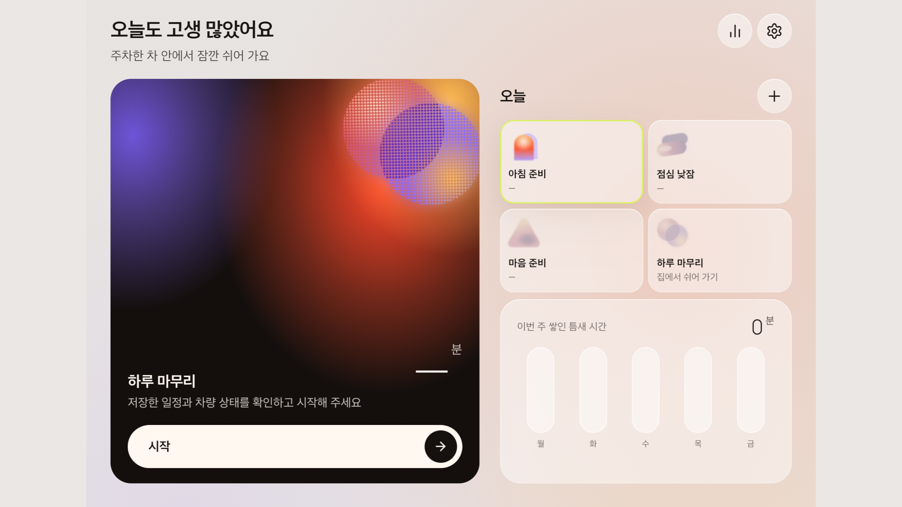
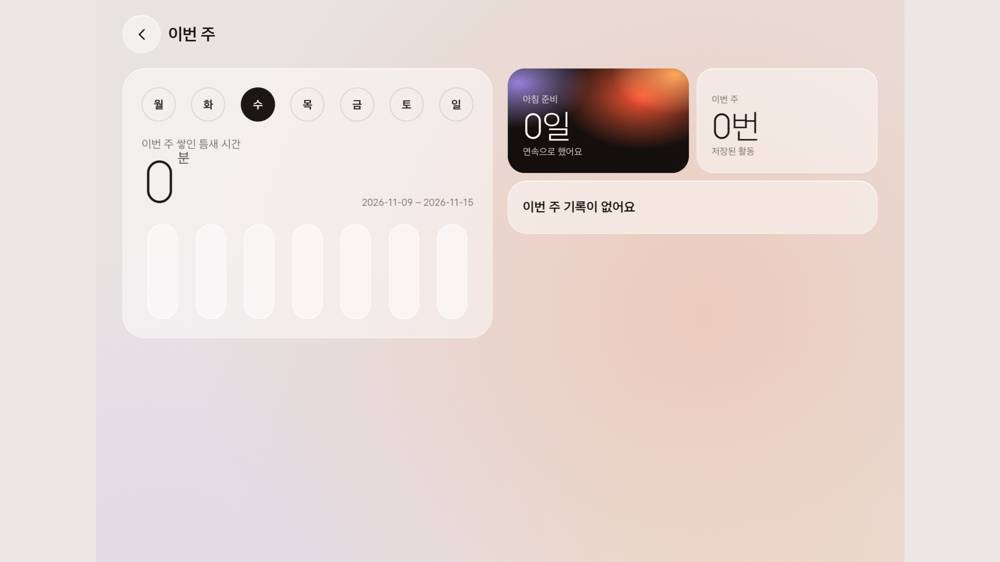
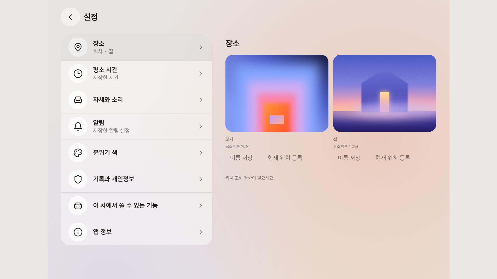

# 틈 - PLEOS 차량 내 마이크로 모먼트 앱

틈은 주차 중 차량에서 보내는 짧은 시간을 출근 준비, 점심 휴식,
미팅 준비, 퇴근 정리에 활용하도록 돕는 PLEOS Connect 앱입니다.
사용자가 상황과 복귀 시간을 선택하면 활동을 진행하고 마무리할 수 있습니다.

제출 팀명: **비트윈 · BETWEEN**

## 앱 실행 화면

### 실제 앱 시연 영상

[에뮬레이터에서 실행한 틈 시연 영상 보기](assets/readme/teum-demo-37b78c9b-1794433115474.mp4)

[자동 도착 제안과 출근 활동 추가 영상 보기](assets/readme/teum-demo-companion-37b78c9b-1794434323091.mp4)

[합성 음성의 인식 결과 확인 영상 보기](assets/readme/teum-voice-review-37b78c9b-st01a1ccf1.mp4)

첫 영상은 실제 앱 조작을 편집한 2분 29초 분량이며 소리는 없습니다.
출근·점심·미팅·퇴근과 기록, 설정, 앱 내 음악 등을 보여 줍니다. 두 번째
영상에는 시뮬레이터 위치를 이용한 자동 도착 제안과 출근 활동이 담겨 있고,
일부 구간에 에뮬레이터 출력음을 증폭해 넣었습니다. 영상의 대기 시간은
편집했으며 실차 제어는 시연하지 않았습니다. 점심의 조기 깨우기와 좌석 선호
설정은 실제 차량 제어 또는 자동 복원을 뜻하지 않습니다. 세 번째 영상에는
합성 음성의 실제 인식 결과가 표시되며, 인식된 문장의 앞과 끝이 일부 누락됐습니다.

2026-11-11 기준 `main`의 소스
`25b285d7ce257d6f310e94eeb6d3c0c03a17c66b`에서 새로 빌드한 APK를
독립된 PLEOS Connect 2.1.0 에뮬레이터에 설치해 실행한 화면입니다.
온보딩을 거쳐 홈의 기록·설정 버튼으로 이동한 뒤 Android `screencap`으로
2560×1440 원본을 캡처했습니다. 새 앱 데이터에서 장소·일정은 등록하지 않았으며,
차량 설정의 지원 여부와 표시 상태는 실행 환경에 따라 달라질 수 있습니다.

### 홈



### 활동 기록

활동을 생성하지 않은 초기 상태로, 누적 시간과 저장된 활동은 0입니다.



### 설정

장소 이름은 미설정이며 위치 권한을 요청하지 않은 상태입니다.



## 차량 제어 검증 범위와 알려진 결함

이 버전은 Pleos Connect 에뮬레이터에서만 시험했습니다. **실제 차량에서의
동작과 안전성은 검증되지 않았으며, 실차에 설치하거나 사용하면 안 됩니다.**
차량 제어 코드에 대한 독립 검토에서 다음 문제가 확인됐고, 전체 수정 및
재검증이 끝나지 않았습니다.

- 화면을 새로고침하거나 다시 불러오는 시점에 이전 화면의 제어 동의가
  무효화되지 않을 수 있습니다.
- 차량 안전 상태가 바뀌는 시점에 오래된 안전 상태를 사용할 가능성이 있습니다.
- 제어 확인 화면에서 표시하는 변경 전 값이 최신 값이 아닐 수 있습니다.
- 중복 제어 명령과 SDK 콜백 종료 처리를 보강한 일부 코드는 단위 테스트를
  통과했지만, 독립 검토의 모든 지적이 해결됐다고 확인된 것은 아닙니다.

에뮬레이터에서 운전석 창문은 틈 앱의 설정 요청 후 SDK 값 `0 → 1`과
Virtual Console 값 `0% → 10%`가 관찰됐고, 이후 원래 값으로 복원했습니다.
별도 실행에서는 요청 직후 조회값과 나중 조회값이 달랐습니다. 이 관찰은
실제 차량 동작이나 모든 창문 영역의 지원을 뜻하지 않습니다.
앰비언트 조명은 운전석 영역 조회가 지원되지 않아 제어하지 못했습니다.
등받이 화면의 각도는 선호값이며, 차량 등받이 이동 제어는 연결되지 않았습니다.

## 현재 구현된 부분

아래는 소스 코드에 반영된 기능입니다. 구현과 실제 차량에서의 검증 완료는
다릅니다. 전체 화면·시나리오 회귀 검증은 요청에 따라 생략했습니다.

- **상황별 활동:** 출근, 점심, 미팅, 퇴근의 네 가지 활동과 단계별 안내.
- **시간 관리:** 복귀 목표와 이동 시간을 반영한 시간표, 남은 시간 안내,
  시간이 부족할 때의 짧은 활동 제안.
- **활동 마무리:** 활동 중 중도 종료와 차량 설정 복원 확인 흐름.
- **차량 안전:** 주차 상태와 이용 제한을 확인하고 제어할 수 없는 경우
  수동 설정을 안내하는 구조. 좌석 자동 이동은 안전 정지 계약 검증 전 비활성화.
- **실천 기록:** 활동 결과와 다음 행동을 기기에 저장하고 조회·수정·삭제하는 기능.
- **소리 안내:** Android TTS를 이용한 음성 안내와 알림음. 기기에서 한국어
  TTS를 사용할 수 없으면 화면 안내와 알림음으로 대체합니다.
- **앱 내 음악:** 미팅 준비 화면의 기존 음악 버튼에서 계정 없이 앱에 포함된
  세 가지 편곡을 선택할 수 있습니다. 다른 활동에서 자동 재생하지 않습니다.

## 개발 및 검증 중인 부분

- 전체 화면·시나리오 회귀 검증은 생략했으므로 개별 확인 결과를 전체
  기능의 통과로 해석하지 않습니다.
- 차량 설정의 적용과 복원은 SDK 지원, 권한, 차량 상태와 실제 응답에 따라
  달라집니다. 실제 차량 제어와 안전 정지 동작은 검증 완료로 가정하지 않습니다.
- 실제 차량, Gleo 음성 호출, 미디어 오디오 포커스와 외부 음악 앱 연동은
  아직 검증되지 않았습니다.

## 아직 구현되지 않은 기능

- Gleo LLM을 이용한 음성 명령 및 대화.
- 멜론 등 외부 음악 앱 연동, 곡 검색·선택·재생 및 개인 플레이리스트 표시.
  Gleo를 통한 음악 앱 제어와 플레이리스트 접근 가능성은 별도 확인이 필요합니다.
- 계정, 서버, 클라우드 분석, 마이크 녹음 및 결제는 초기 계획 범위에 포함되지
  않았습니다. 음악 서비스 연동은 별도의 기능 범위와 권한 검토가 필요합니다.

## Pleos 개발환경

이 프로젝트는 Pleos Connect용 Kotlin Android 앱으로 Vehicle SDK를 사용합니다.
아래 설치·실행 기록은 초기 개발환경을 확인한 시점의 기록입니다.

### 설치 현황

2026-11-02 기준:

- 설치 완료: Android Studio 2026.2, Android 명령줄 도구 22.0, Temurin JDK 21.0.13.
- SDK 설치 완료: API 34/35, Build-Tools 35.0.0, Platform-Tools 37.0.1, Emulator 37.2.13.
- Pleos 설치 완료: Connect 2.1.0 ARM64 이미지, Vehicle Service 2.3.22.
- AVD: `Pleos_Connect_2_1_0`, RAM 4GB, 2560x1440, GPU host, Cold boot.
- 빌드 검증: `./gradlew --no-daemon clean assembleDebug lintDebug` 성공, lint `No issues found`.
- 실행 검증: Android 14 / ARM64 부팅, APK 설치 성공, `MainActivity` 실행 및 화면 확인.
- 로컬 실행 증거: `.omo/evidence/pleos-setup.png` (Git 제외).

이 검증은 초기 개발환경에 대한 기록이며, 현재 앱의 전체 기능이나 실제 차량 동작을 보증하지 않습니다.

### 프로젝트 버전

| 항목 | 버전 |
| --- | --- |
| Vehicle SDK | 2.3.2 |
| Android Gradle Plugin | 8.8.2 |
| Kotlin | 2.0.0 |
| Gradle wrapper | 8.10.2 |
| compileSdk | 35 |
| targetSdk | 35 |
| minSdk | 28 |
| Java/Kotlin 바이트코드 | 17 |
| 실행 대상 | Pleos Connect 2.1.0, Android API 34, ARM64 |

빌드 도구는 공식 Vehicle SDK Sample App의 조합을 기준으로 선택했습니다.
`compileSdk` 35는 빌드용이며, API 34 에뮬레이터에서 실행할 수 있습니다.
`targetSdk` 35는 공식 Sample App과 동일하며, 실제 배포 전에는 최신 배포 요건을 확인하세요.

### 로컬 경로

- Android Studio: `/Applications/Android Studio.app`
- 빌드용 Java: Temurin JDK 21.0.13 (`$HOME/Library/Java/JavaVirtualMachines/jdk-21.0.13+9/Contents/Home`)
- Android SDK: `$HOME/Library/Android/sdk`
- SDK 명령줄 도구: `$ANDROID_HOME/cmdline-tools/latest/bin`
- Gradle의 SDK 경로: `local.properties` (Git 제외)
- Android Studio의 Gradle JDK: `.idea/gradle.xml`과 `.gradle/config.properties` (Git 제외)
- 셸 환경변수: `~/.zprofile`의 `Pleos / Android development` 항목

### Android Studio에서 열기

1. Android Studio에서 이 디렉터리를 엽니다.
2. Gradle JDK는 `GRADLE_LOCAL_JAVA_HOME`으로 설정되어 있으며, 설치된 Temurin JDK 21을 참조합니다.
3. SDK 및 Gradle 동기화가 끝나면 실행 대상으로 `Pleos_Connect_2_1_0`을 선택합니다.
4. `app` 실행 구성을 Run 합니다.

Android Studio 내장 Java 25는 Gradle 8.10.2와 호환되지 않으므로 빌드용 JDK로 선택하지 마세요.
이 저장소를 다른 컴퓨터에 복사하면 `local.properties`와 로컬 JDK 설정을 해당 컴퓨터 경로로 지정해야 합니다.

### 에뮬레이터 실행

Android Studio의 Device Manager에서 `Pleos_Connect_2_1_0`을 실행하거나 다음 명령을 사용합니다.

```sh
source ~/.zprofile
emulator -avd Pleos_Connect_2_1_0 -no-snapshot -gpu host
```

설치 검증에 사용한 에뮬레이터가 이미 실행 중이라면 다시 실행하지 않아도 됩니다.
차량 상태 테스트 도구 `ai.pleos.connectwebconsole`도 시스템 이미지에 포함되어 있습니다.

### 터미널에서 빌드

새 로그인 터미널을 열거나 `source ~/.zprofile`로 환경변수를 적용합니다.

```sh
./gradlew assembleDebug lintDebug
./gradlew installDebug
adb -s emulator-5554 shell am start -n dev.pleos.starter/.MainActivity
```

개발용 APK 경로: `app/build/outputs/apk/debug/app-debug.apk`
여러 기기를 연결한 경우 `adb devices`에서 대상 시리얼을 확인하세요.

### 제출용 release APK

- 저장소 내 경로: [`apk/비트윈 · BETWEEN_틈_release.apk`](apk/비트윈%20%C2%B7%20BETWEEN_틈_release.apk)
- 버전: `0.1.0` (`versionCode 1`)
- 개발 및 기존 debug APK 검증 환경: Pleos Connect 2.1.0, Android 14/API 34,
  ARM64, Vehicle SDK 2.3.2, Vehicle Service 2.3.22, 2560×1440 화면.
- release APK 실행 확인: 2026-11-12에 별도 Pleos Connect 2.1.0
  에뮬레이터에 설치해 앱 시작 화면을 확인했습니다. 이 확인은 차량 제어의
  안전성이나 전체 시나리오 검증을 뜻하지 않습니다.
- 알려진 제어 결함과 미지원 기능은 위의 **차량 제어 검증 범위와 알려진 결함**
  항목을 확인하세요. 실차 설치·사용은 검증되지 않았습니다.

서명된 APK를 에뮬레이터에 설치하려면 에뮬레이터의 시리얼을 확인하고 실행합니다.

```sh
adb -s <에뮬레이터-시리얼> install "apk/비트윈 · BETWEEN_틈_release.apk"
adb -s <에뮬레이터-시리얼> shell am start -n dev.pleos.starter/.MainActivity
```

`./gradlew :app:assembleRelease`는 서명 전 APK를 생성합니다. 제출용 APK의
서명키와 비밀번호는 저장소에 포함하지 않습니다. 다른 서명키로 설치된 동일
패키지는 서명 불일치로 덮어 설치되지 않을 수 있습니다.

### 확인된 도구 안내

- AGP 8.8.2와 최신 SDK 도구 조합에서 `SDK XML versions up to 3 ... version 4` 안내 경고가 출력됩니다.
  경고를 숨기지 않았으며, 이 조합으로 클린 빌드·lint·Pleos에서의 앱 실행을 검증했습니다.
- 최신 Android 명령줄 도구는 `sdkmanager` 대신 `android sdk` 사용을 안내합니다.
  설치된 `sdkmanager`와 `avdmanager`로 SDK 설치와 AVD 생성이 정상 동작하는 것을 확인했습니다.

차량 API를 사용할 때는 필요한 권한만 Manifest에 선언하고,
Capability 확인 및 비동기 결과 처리를 구현해야 합니다.
SDK 의존성이 포함됐다는 사실만으로 Vehicle Service 연결이나 API 사용 권한이 검증되는 것은 아닙니다.

### 공식 문서

- [개발 환경 구성](https://document.pleos.ai/docs/connect/guide/getting-started/application-development/setup-connect-sdk-emulator)
- [Vehicle SDK Sample App](https://document.pleos.ai/docs/pleos-only/tutorial/vehicle-sdk-sample-app)
- [SDK 릴리즈 노트](https://document.pleos.ai/docs/pleos-only/release-note/sdk-release-note)
