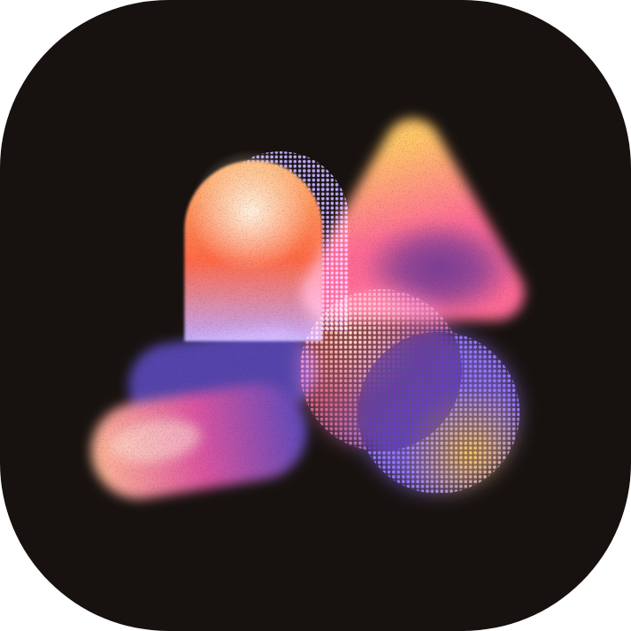
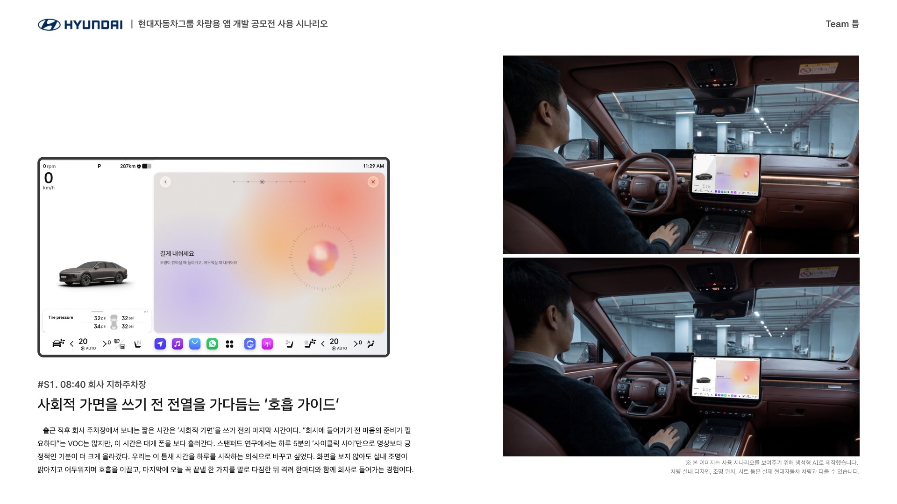
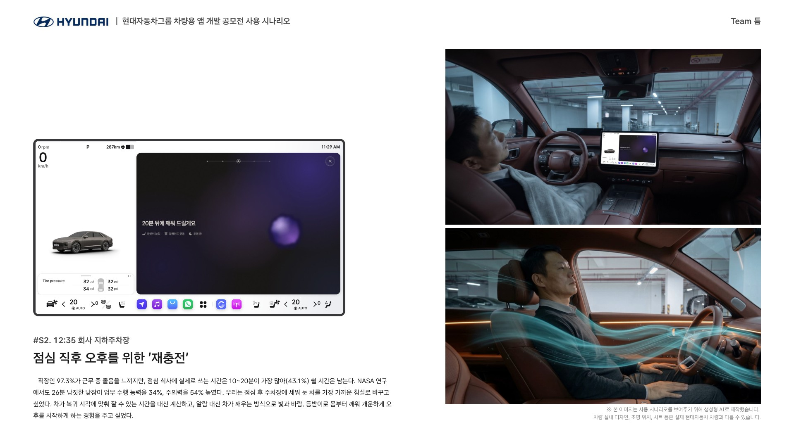
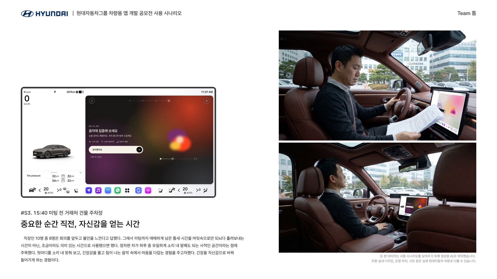
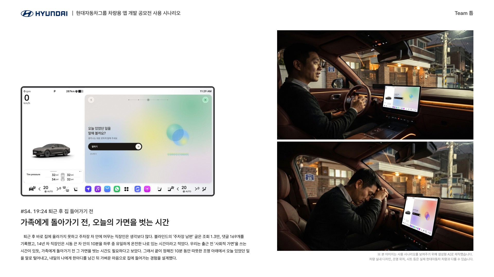
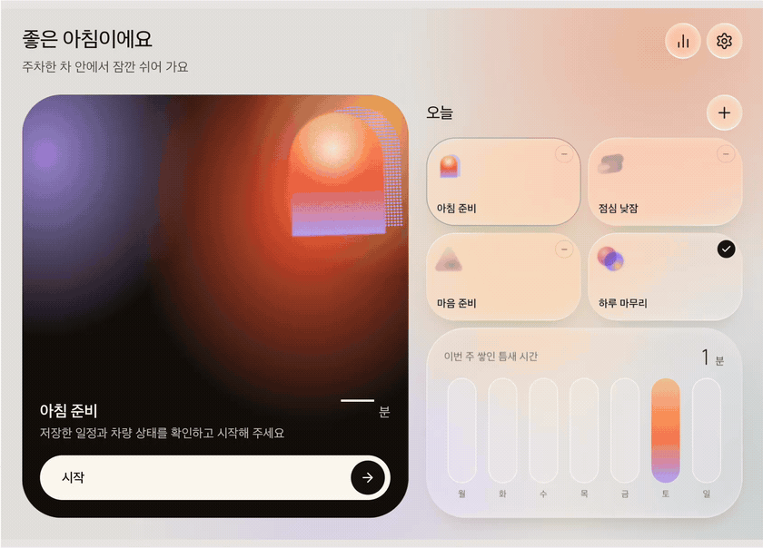

<p align="center">
  
</p>

<h1 align="center">틈</h1>
<p align="center"><strong>차 안의 짧은 시간, 나를 위한 틈으로</strong></p>
<p align="center">PLEOS Connect 차량 내 마이크로 모먼트 앱 · 비트윈 BETWEEN</p>

틈은 주차한 차 안에서 보내는 짧은 시간을 출근 준비와 점심 휴식, 미팅 준비,
퇴근 정리에 알맞게 쓰도록 돕는 앱입니다. 현재 상황과 복귀할 시각을 고른 뒤
화면을 따라 활동을 시작하고 마무리하면 됩니다.

> **에뮬레이터 전용 시연입니다.** 실제 차량에서의 동작과 안전성은 검증하지
> 않았습니다. 알려진 차량 제어 결함이 있으니 실차에는 설치하거나 쓰지 마세요.

## 서비스 시나리오








## 틈 둘러보기



아이콘과 첫 화면 이름을 변경하기 전 debug APK를 전용 에뮬레이터에서 약 5초
간격으로 조작한 55초 무음 시연입니다. 하루 마무리 활동과 감정 선택, 주간
기록, 저장한 기록 조회 흐름을 담았으며 차량 제어·복구와 음성 입력은 이번
시연이나 검증에 넣지 않았습니다.

## 틈에서 할 수 있는 일

출근 전 준비부터 점심 휴식과 미팅 준비, 퇴근 뒤 정리까지 네 가지 상황에 맞춰
원하는 활동을 바로 고릅니다. 복귀 목표 시각과 이동 시간을 함께 따져 남은 시간을
살피고, 활동이 끝나면 오늘의 기록을 남깁니다.

[구현 범위와 제한](#현재-구현된-부분) · [차량 제어 안전 안내](#차량-제어-검증-범위와-알려진-결함) · [빌드와 실행](#pleos-개발환경)

## 차량 제어 검증 범위와 알려진 결함

이 버전은 Pleos Connect 에뮬레이터에서만 시험했습니다. **실제 차량에서의
동작과 안전성은 검증하지 않았으므로 실차에 설치하거나 쓰면 안 됩니다.**
차량 제어 코드를 독립 검토한 결과 아래 문제를 확인했고, 전체 수정과 재검증은
아직 마무리하지 못했습니다.

- 화면을 새로고침하거나 다시 불러올 때 이전 화면의 제어 동의가 그대로 남을 수 있습니다.
- 차량 안전 상태가 바뀌는 순간에 이전 안전 상태를 참조할 수 있습니다.
- 제어 확인 화면에서 표시하는 변경 전 값이 최신 값이 아닐 수 있습니다.
- 중복 제어 명령과 SDK 콜백 종료 처리를 보강한 일부 코드는 단위 테스트를
  통과했지만, 독립 검토에서 지적한 문제가 모두 해결됐다고 확인된 것은 아닙니다.
- 등받이를 움직이는 동안 화면을 다시 불러오거나 컨트롤러가 바뀌면 이전 명령과
  새 명령이 겹치거나, 이전 정지 응답이 새 동작에 간섭할 수 있습니다. 독립
  검토에서 지적한 문제이며 해결 및 재검증되지 않았습니다.
- 앱 프로세스가 강제 종료될 때 등받이가 스스로 멈추는지는 확인하지 않았습니다.

에뮬레이터에서 운전석 창문은 틈 앱이 설정을 요청한 뒤 SDK 값 `0 → 1`,
Virtual Console 값 `0% → 10%`로 바뀌었고 이후 원래 값으로 되돌렸습니다.
다만 다른 실행에서는 요청 직후 읽은 값과 나중에 읽은 값이 달랐습니다. 이 결과만으로
실제 차량 동작이나 모든 창문 영역 지원을 보장하지는 않습니다.
별도 에뮬레이터 시험에서는 지원하는 통합 영역의 앰비언트 밝기와 색상이 바뀌는
것을 확인했습니다. 등받이 이동과 정지는 지정된 에뮬레이터의 debug 빌드에서만
허용하며, 콘솔 위치와 SDK 조회값이 어긋나는 제약이 남아 있습니다.
따라서 현재 GIF에 나온 모든 기능이나 실차 동작을 검증했다고 볼 수는 없습니다.

## 현재 구현된 부분

현재 소스 코드에 넣어 둔 기능 목록입니다. 코드로 구현해 둔 것과 실제 차량에서
검증까지 마친 것은 별개이며, 전체 화면·시나리오 회귀 검증은 요청에 따라 생략했습니다.

- 상황별 활동: 출근, 점심, 미팅, 퇴근 네 가지 활동과 단계별 안내를 담았습니다.
- 시간 관리: 복귀 목표와 이동 시간을 반영한 시간표, 남은 시간 안내, 시간이
  부족할 때 고르는 짧은 활동을 지원합니다.
- 활동 마무리: 활동 중 중도 종료와 차량 설정 복원 확인 흐름.
- 차량 안전: 주차 상태와 이용 제한을 먼저 살피고, 직접 제어할 수 없을 때는
  수동 설정을 안내합니다. 등받이 이동은 지정된 에뮬레이터의 debug 빌드로만 제한했습니다.
- 실천 기록: 활동 결과와 다음 행동을 기기에 저장하고 조회·수정·삭제합니다.
- 소리 안내: Android TTS 음성 안내와 알림음을 쓰며, 기기에서 한국어 TTS를
  쓸 수 없으면 화면 안내와 알림음으로 대신합니다.
- 앱 내 음악: 미팅 준비 화면의 기존 음악 버튼에서 계정 없이 앱에 내장된
  세 가지 편곡을 고릅니다. 다른 활동에서는 자동 재생하지 않습니다.

## 개발 및 검증 중인 부분

- 전체 화면·시나리오 회귀 검증은 생략했기 때문에 개별 확인 결과를 전체 기능
  통과로 읽지 않습니다.
- 차량 설정을 적용하고 되돌리는 동작은 SDK 지원 여부와 권한, 차량 상태, 실제
  응답에 좌우되므로 실제 차량 제어와 안전 정지가 검증됐다고 가정하지 않습니다.
- 실제 차량 연동과 Gleo 음성 호출, 미디어 오디오 포커스, 외부 음악 앱 연동은
  아직 검증하지 않았습니다.

## 아직 구현되지 않은 기능

- Gleo LLM 음성 명령과 대화는 아직 넣지 않았습니다.
- 멜론 등 외부 음악 앱 연동과 곡 검색·선택·재생, 개인 플레이리스트 표시도
  미구현 상태입니다. Gleo로 음악 앱을 제어하거나 플레이리스트에 접근할 수
  있는지는 따로 확인해야 합니다.
- 계정, 서버, 클라우드 분석, 마이크 녹음, 결제는 초기 계획 범위에 넣지
  않았습니다. 음악 서비스 연동은 기능 범위와 권한을 별도로 검토해야 합니다.

## Pleos 개발환경

Pleos Connect에서 돌아가는 Kotlin Android 앱이며 Vehicle SDK를 사용합니다.
아래에 적은 설치·실행 기록은 초기 개발환경을 처음 점검했을 때 남긴 기준입니다.

### 설치 현황

2026-11-02 기준:

- 설치 완료: Android Studio 2026.2, Android 명령줄 도구 22.0, Temurin JDK 21.0.13.
- SDK 설치 완료: API 34/35, Build-Tools 35.0.0, Platform-Tools 37.0.1, Emulator 37.2.13.
- Pleos 설치 완료: Connect 2.1.0 ARM64 이미지, Vehicle Service 2.3.22.
- AVD: `Pleos_Connect_2_1_0`, RAM 4GB, 2560x1440, GPU host, Cold boot.
- 빌드 검증: `./gradlew --no-daemon clean assembleDebug lintDebug` 성공, lint `No issues found`.
- 실행 검증: Android 14 / ARM64 부팅, APK 설치 성공, `MainActivity` 실행 및 화면 확인.
- 로컬 실행 증거: `.omo/evidence/pleos-setup.png` (Git 제외).

초기 개발환경을 점검한 기록일 뿐이며, 현재 앱의 전체 기능이나 실제 차량에서의 동작까지 보증하지는 않습니다.

### 프로젝트 버전

| 항목 | 버전 |
| --- | --- |
| Vehicle SDK | 2.3.2 |
| Android Gradle Plugin | 8.8.2 |
| Kotlin | 2.0.0 |
| Gradle wrapper | 8.10.2 |
| compileSdk | 35 |
| targetSdk | 35 |
| minSdk | 28 |
| Java/Kotlin 바이트코드 | 17 |
| 실행 대상 | Pleos Connect 2.1.0, Android API 34, ARM64 |

빌드 도구 버전은 공식 Vehicle SDK Sample App 조합에 맞췄으며,
`compileSdk` 35로 빌드해 API 34 에뮬레이터에서 바로 실행합니다.
`targetSdk` 35 역시 공식 Sample App과 같으며, 실제 배포 전에는 최신 배포 요건을 확인하세요.

### 로컬 경로

- Android Studio: `/Applications/Android Studio.app`
- 빌드용 Java: Temurin JDK 21.0.13 (`$HOME/Library/Java/JavaVirtualMachines/jdk-21.0.13+9/Contents/Home`)
- Android SDK: `$HOME/Library/Android/sdk`
- SDK 명령줄 도구: `$ANDROID_HOME/cmdline-tools/latest/bin`
- Gradle의 SDK 경로: `local.properties` (Git 제외)
- Android Studio의 Gradle JDK: `.idea/gradle.xml`과 `.gradle/config.properties` (Git 제외)
- 셸 환경변수: `~/.zprofile`의 `Pleos / Android development` 항목

### Android Studio에서 열기

1. Android Studio에서 이 디렉터리를 엽니다.
2. Gradle JDK는 `GRADLE_LOCAL_JAVA_HOME`으로 잡혀 있으며 설치된 Temurin JDK 21을 가리킵니다.
3. SDK와 Gradle 동기화가 끝나면 실행 대상으로 `Pleos_Connect_2_1_0`을 고릅니다.
4. `app` 실행 구성을 Run 합니다.

Android Studio에 내장된 Java 25는 Gradle 8.10.2와 호환되지 않으므로 빌드용 JDK로 고르지 마세요.
이 저장소를 다른 컴퓨터로 옮겨 열 때는 `local.properties`와 로컬 JDK 경로도 그 컴퓨터 환경에 맞게 다시 잡아 주어야 합니다.

### 에뮬레이터 실행

Android Studio의 Device Manager에서 `Pleos_Connect_2_1_0`을 바로 켜거나 아래 명령을 실행합니다.

```sh
source ~/.zprofile
emulator -avd Pleos_Connect_2_1_0 -no-snapshot -gpu host
```

설치 검증에 쓴 에뮬레이터가 이미 켜져 있으면 다시 띄우지 않아도 되며,
시스템 이미지에는 차량 상태 테스트 도구 `ai.pleos.connectwebconsole`도 함께 들어 있습니다.

### 터미널에서 빌드

새 로그인 터미널을 열거나 `source ~/.zprofile`을 실행해 환경변수를 먼저 불러옵니다.

```sh
./gradlew assembleDebug lintDebug
./gradlew installDebug
adb -s emulator-5554 shell am start -n dev.pleos.starter/.MainActivity
```

개발용 APK 경로: `app/build/outputs/apk/debug/app-debug.apk`
기기를 여러 대 연결했다면 `adb devices`로 대상 시리얼을 먼저 확인하세요.

### 최신 디버그 APK

- 파일: [아이콘·이름 변경 디버그 APK](apk/틈_아이콘이름_디버그_20261115.apk)
- SHA-256: `f1059631caf520122036ea32d0fa904bc30a06f4c4347b1d54cb0e8cbf7fb4d4`
- 전용 Pleos Connect 에뮬레이터에서 첫 화면의 ‘틈’과 런처 아이콘을 확인했습니다.
- 에뮬레이터용 테스트 빌드이며 실차에는 설치하거나 쓰지 마세요.

### 서명된 최신 release APK

- 저장소 내 경로: [`apk/비트윈 · BETWEEN_틈_release.apk`](apk/비트윈%20%C2%B7%20BETWEEN_틈_release.apk)
- 버전: `0.1.0` (`versionCode 1`)
- SHA-256: `c84c09c9764296382e7758edf218fa5a4dee40ede6355a4cd2522e1fa62207f5`
- 기존 제출 APK와 동일한 릴리스 키로 서명했습니다.
- 개발 및 기존 debug APK 검증 환경: Pleos Connect 2.1.0, Android 14/API 34,
  ARM64, Vehicle SDK 2.3.2, Vehicle Service 2.3.22, 2560×1440 화면.
- 별도 Pleos Connect 에뮬레이터에 설치해 시작 화면과 런처 아이콘을 확인했습니다.
  차량 제어 안전성이나 전체 시나리오까지 검증한 것은 아닙니다.
- 알려진 제어 결함과 미지원 기능은 위의 **차량 제어 검증 범위와 알려진 결함**을
  참고하세요. 실차에는 설치하거나 쓰지 마세요.

서명된 APK를 에뮬레이터에 올리려면 먼저 기기 시리얼을 확인한 뒤 아래 명령을 실행합니다.

```sh
adb -s <에뮬레이터-시리얼> install "apk/비트윈 · BETWEEN_틈_release.apk"
adb -s <에뮬레이터-시리얼> shell am start -n dev.pleos.starter/.MainActivity
```

`./gradlew :app:assembleRelease`는 서명하기 전 단계의 APK만 생성합니다. 제출용
APK의 서명키와 비밀번호는 저장소에 넣지 않습니다. 디버그 APK처럼 다른 키로
서명한 같은 패키지가 이미 깔려 있다면 서명 불일치로 덮어 설치할 수 없습니다.
기존 앱을 삭제하면 기록과 설정도 삭제되므로 별도 에뮬레이터를 사용하세요.

### 확인된 도구 안내

- AGP 8.8.2와 최신 SDK 도구를 함께 쓰면 `SDK XML versions up to 3 ... version 4` 안내 경고가 출력되지만,
  경고를 감추지 않은 채로 클린 빌드·lint·Pleos 앱 실행까지 모두 확인했습니다.
- 최신 Android 명령줄 도구는 `sdkmanager` 대신 `android sdk`를 쓰도록 안내하지만,
  설치된 `sdkmanager`와 `avdmanager`로 SDK 설치와 AVD 생성이 정상 동작하는 것을 확인했습니다.

차량 API는 꼭 필요한 권한만 Manifest에 선언하고, Capability 확인과 비동기
응답 처리를 함께 구현해야 합니다. SDK 의존성을 추가했다는 것만으로 Vehicle
Service 연결이나 API 호출 권한까지 검증되지는 않습니다.

### 공식 문서

- [개발 환경 구성](https://document.pleos.ai/docs/connect/guide/getting-started/application-development/setup-connect-sdk-emulator)
- [Vehicle SDK Sample App](https://document.pleos.ai/docs/pleos-only/tutorial/vehicle-sdk-sample-app)
- [SDK 릴리즈 노트](https://document.pleos.ai/docs/pleos-only/release-note/sdk-release-note)
